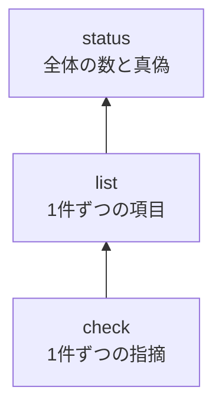

# kotowari status

[English](status.md) | 日本語

<!-- @kotowari[docs/decisions/core/status.md#status-reads-the-same-things-as-check-and-runs-the-same-checks-and-outputs-counts-and-complete-instead-of-findings:6190a33e] -->

`kotowari status` は、決定の文書（仕様）とテストが「いま揃っているか」を、数と1つの真偽で答えるコマンドです。
CI に1行足しておくと、誤りや未決を残したままの変更を止められます。

## 3 つの読み取りコマンドの中での位置

<!-- @kotowari[docs/decisions/core/status.md#status-reads-the-same-things-as-check-and-runs-the-same-checks-and-outputs-counts-and-complete-instead-of-findings:6190a33e] -->

kotowari で仕様を読む道具は、段になっています。



- 何が悪いかを直すときは [`check`](./check.ja.md)
- どの確認することの行にどのテストが付いているかを見るときは [`list`](./list.ja.md)
- 全体が出してよい状態かを知りたいときは `status`

`status` は独自の判定を持たず、`check` と同じ設定、同じ検査の結果を集計するだけです。
そのため `check` と `status` の結論が食い違うことはありません。

## 書式

<!-- @kotowari[docs/decisions/core/cli.md#the-options-each-command-accepts-are-fixed-and-options-and-positional-arguments-may-be-written-in-any-order:94339fbd, docs/decisions/core/cli.md#an-option-not-accepted-an-unknown-command-an-extra-positional-argument-or-an-option-with-a-wrong-value-stops-with-an-argument-error:11a07c33] -->

```sh
kotowari status [--format json|text] [--config <path>]
kotowari status --help
kotowari status --version
```

オプションはコマンドの前にも後にも書けます。
位置引数は取りません。

## オプションと引数

<!-- @kotowari[docs/decisions/core/status.md#the-output-is-json-or-text-and-text-has-one-line-per-group:7b83738d, docs/decisions/core/config.md#the-configuration-file-is-placed-at-kotowariconfigyaml-in-the-base-directory-and---config-can-point-at-another-file:7c217b47] -->

| 名前 | 値 | 既定 | 説明 |
|---|---|---|---|
| `--format` | `json` か `text` | `json` | 出力の形 |
| `--config` | 設定ファイルのパス | 基準のディレクトリの `.kotowari/config.yaml` | 読む設定ファイル。パスはカレントディレクトリからの相対で読みます |
| `--help` | なし | — | 使い方を出して終わります |
| `--version` | なし | — | 版を出して終わります |

共通のオプションと基準のディレクトリの細部は [CLI の共通事項](../cli.ja.md) にあります。

## 出力

`status` は `check` と同じ設定と置き場から、決定の文書、テストのファイル、ガイド、全体像の元データを読み、`surface.rules` が空の一覧でなければ面のファイル、面の規則のファイル、未記載の面の一覧も読んで、`check` と同じ検査を行います。
指摘そのものは出さず、数と `complete` だけを出します。

### text

<!-- @kotowari[docs/decisions/core/status.md#the-output-is-json-or-text-and-text-has-one-line-per-group:7b83738d] -->

群ごとに1行、`群 鍵=値 鍵=値 …` の形で出します。
鍵の語は JSON と同じで、値は半角空白1つで区切り、桁揃えの空白は入れません。
最後の行は `complete true` か `complete false` です。

`tests` の行だけは、JSON の `files` を `拡張子=ファイルの数` に展開します（例 `tests marks=2 rs=1`）。

### JSON

<!-- @kotowari[docs/decisions/core/status.md#the-summary-outputs-per-group-the-counts-of-test-markers-guides-overview-surfaces-and-findings:d52c4092, docs/decisions/core/status.md#the-number-of-confirmation-rows-is-output-split-into-those-with-tests-those-without-and-those-by-reading:4b92a0ae, docs/decisions/core/confirmations.md#the-implementing-side-changes-the-status-and-decisions-not-built-yet-stay-proposed:436adde2] -->

最上位は、次の群の鍵だけを持つオブジェクトです。
鍵の定義はすべて [status の決定](../../decisions/core/status.ja.md) にあります。

| 群 | 鍵 | 型 | 説明 |
|---|---|---|---|
| `documents` | `files`、`lines` | 数 | 読んだ決定の文書の数（用語集は数えない）と、行数の合計 |
| `tests` | `marks` | 数 | 印の出現の数。1つの印に ID が複数あれば ID ごとに1つ |
| `tests` | `files` | オブジェクト | `check` の JSON の `tests` と同じ。鍵は拡張子、値は `files`（ファイルの数）と `query`（問い合わせのある言語か） |
| `guides` | `files`、`marks` | 数 | 読んだガイドの数と、ガイドの印の数（`check` の `guides` と同じ） |
| `overview` | `files`、`marks` | 数 | 読んだ全体像の元データの数と、その中のガイドの印の数（`check` の `overview` と同じ）。設定に `overview` の鍵が無ければどちらも 0 |
| `surface` | `total`、`specified`、`unspecified` | 数 | 面の種類と名前の組の数、そのうち決定に引用されているもの、引用されていないが未記載の面の一覧で外しているものの数（[面の検査](../surface.ja.md)）。`surface.rules` が空の一覧なら3つとも 0 |
| `decisions` | `proposed`、`implemented` | 数 | 状態ごとの決定の数。状態の行が誤った決定はどちらにも数えない |
| `confirmations` | `with_tests`、`without_tests`、`by_reading` | 数 | どちらの状態の決定の行も含めた確認することの行のうち、テストの印が指すもの、どの印も指さないもの、`（読んで確認）` で始まるもの（ここにだけ数える） |
| `findings` | `error`、`notice` | 数 | `check` の誤りと注意の数 |
| `complete` | （値だけ） | 真偽 | 揃っているか。条件は次の節 |

### よく見る数

<!-- @kotowari[docs/decisions/core/status.md#the-summary-outputs-per-group-the-counts-of-test-markers-guides-overview-surfaces-and-findings:d52c4092, docs/decisions/core/status.md#the-number-of-confirmation-rows-is-output-split-into-those-with-tests-those-without-and-those-by-reading:4b92a0ae] -->

よく見る数だけを挙げます。

| 行 | 見るところ | こういうときに気にする |
|---|---|---|
| `decisions` | `proposed` | 決めたが、まだ作っていない決定の数。欠陥ではなく、作り残しの量を示す |
| `confirmations` | `without_tests` | どのテストも指していない行。実装済みの決定の行なら1件ずつ `check` の誤りになる。提案の決定の行もここに数えるが、誤りにはならない |
| `confirmations` | `by_reading` | 人か LLM が読んで確かめる行。kotowari は確かめないので、レビューで確かめる |
| `guides` | `files` / `marks` | 読んだガイドの数と、ガイドの印の数。設定の glob を書き間違えると 0 になる |
| `surface` | `unspecified` | 決定に引用しないまま、未記載の面の一覧で外している面の数。導入の残りの量の目安で、0 に近づけていく |
| `findings` | `error` / `notice` | `check` の指摘の数。`notice` は注意で、揃っているかの判定には効かない |

### `complete` が true になる条件

<!-- @kotowari[docs/decisions/core/status.md#the-exit-code-is-0-when-complete-and-1-otherwise:ba9a7aed, docs/decisions/core/decision-documents.md#write-questions-handed-back-to-people-in-the-open-section-of-the-topic-document:8286069a] -->

`complete` が true になるのは、次の2つが両方とも成り立つときだけです。

1. `check` の誤り（`error`）が 0 件
2. どの決定の文書の `## 未決` にも項目が無い

注意（`notice`）はいくつあっても `complete` を妨げません。
注意は直す価値のある手がかりですが、リリースを止める理由ではない、という区別です。
提案のまま置いた決定も、これを妨げません。

## 終了コード

<!-- @kotowari[docs/decisions/core/status.md#the-exit-code-is-0-when-complete-and-1-otherwise:ba9a7aed, docs/decisions/core/status.md#status-reads-the-same-things-as-check-and-runs-the-same-checks-and-outputs-counts-and-complete-instead-of-findings:6190a33e] -->

終了コードは `complete` の答えをそのまま映します。

| コード | 意味 |
|---|---|
| 0 | 揃っている（`complete true`）。`--help` か `--version` で終わったときも 0 |
| 1 | 揃っていない（`complete false`） |
| 2 | 停止した（設定が読めないなど、集計できなかった。理由は標準エラーに出ます） |

停止の理由と文言は `check` と同じです（[CLI の共通事項](../cli.ja.md)）。

## 例

### 使ってみる

<!-- @kotowari[docs/decisions/core/status.md#the-output-is-json-or-text-and-text-has-one-line-per-group:7b83738d] -->

リポジトリの直下で実行します。
人が読むなら `--format text` が便利です。
[`kotowari list` の例](./list.ja.md#例)の決定の文書で、テストで確かめる2つの行の両方にテストを付けたときの結果です。

```console
$ kotowari status --format text
documents files=1 lines=36
tests marks=2 rs=1
guides files=0 marks=0
overview files=0 marks=0
surface total=0 specified=0 unspecified=0
decisions proposed=0 implemented=2
confirmations with_tests=2 without_tests=0 by_reading=1
findings error=0 notice=0
complete true
```

最後の `complete true` が答えで、その上の行は内訳です。

既定の出力は JSON で、鍵の名前は text と同じです。
スクリプトやエージェントが読むときはこちらを使います。

```console
$ kotowari status | jq .complete
true
```

### CI で使う

<!-- @kotowari[docs/decisions/core/status.md#the-exit-code-is-0-when-complete-and-1-otherwise:ba9a7aed] -->

終了コードがそのまま判定なので、ジョブの1ステップに足すだけで済みます。

```yaml
# GitHub Actions の例（kotowari の導入手順は省略）
- name: 仕様が揃っているか
  run: kotowari status --format text
```

揃っていなければジョブが失敗し、ログにどの数がおかしいかが残ります。
細かい理由は、同じチェックアウトで `kotowari check --format text` を実行して1件ずつ見ます。

## よくあるつまずき

### `without_tests` が 0 でないのに、check に誤りが無い

<!-- @kotowari[docs/decisions/core/status.md#the-number-of-confirmation-rows-is-output-split-into-those-with-tests-those-without-and-those-by-reading:4b92a0ae, docs/decisions/core/confirmations.md#the-implementing-side-changes-the-status-and-decisions-not-built-yet-stay-proposed:436adde2, docs/decisions/core/list.md#a-confirmation-row-gets-the-tests-that-point-at-it-and-a-decision-gets-a-fingerprint:64ab7c66] -->

`without_tests` には提案の決定の行も数え、その行にはまだテストが要りません。
例に、行を1つ持つ提案の決定を足すと次のようになります。

```console
$ kotowari check --format text
$ kotowari status --format text | grep -E '^(decisions|confirmations|complete)'
decisions proposed=1 implemented=2
confirmations with_tests=2 without_tests=1 by_reading=1
complete true
```

実装済みの決定の行でまだテストの要るものを探すには、`check` を読むか、`list` を絞ります。`kotowari list | jq -r '.items[] | select(.kind == "confirmation" and .state == "implemented" and .tests == [] and (.by_reading | not)) | .id'` です。

### check に誤りが無いのに `complete` が false

<!-- @kotowari[docs/decisions/core/status.md#the-exit-code-is-0-when-complete-and-1-otherwise:ba9a7aed, docs/decisions/core/decision-documents.md#write-questions-handed-back-to-people-in-the-open-section-of-the-topic-document:8286069a] -->

どこかの決定の文書の `## 未決` に項目があります。人に戻した問いが、まだ答えを待っています。

```console
$ kotowari check --format text
$ echo $?
0
$ kotowari status --format text | grep '^complete'
complete false
```

人が決め、その決定を書き、`## 未決` から項目を消すまで、`complete` は true になりません。

### `config error: ...: matched by both guides.files and tests.files` で止まる

<!-- @kotowari[docs/decisions/core/status.md#status-reads-the-same-things-as-check-and-runs-the-same-checks-and-outputs-counts-and-complete-instead-of-findings:6190a33e, docs/decisions/core/guides.md#when-the-guide-and-test-locations-overlap-it-is-a-stop-with-a-configuration-error:4b7987f7] -->

`status` も `check` と同じくガイドを読むので、設定の `guides.files` と `tests.files` の glob が同じファイルに当たると止まります。
`list` と `query` はガイドを読まないのでこの停止をせず、「list は動くのに status は止まる」ことがあるのはこのためです。
2つの glob が重ならないように直します（[設定](../config.ja.md)）。

## 関連

- 仕様: [status の決定](../../decisions/core/status.ja.md)
- 指摘を1件ずつ見る: [`kotowari check`](./check.ja.md)
- 決定と行とテストを1件ずつ見る: [`kotowari list`](./list.ja.md)
- 1つの決定か行を本文つきで見る: [`kotowari query`](./query.ja.md)
- 指摘の種類: [指摘の一覧](../findings.ja.md)
- 共通のオプション、停止、基準のディレクトリ: [CLI の共通事項](../cli.ja.md)
- 設定ファイル: [設定](../config.ja.md)
