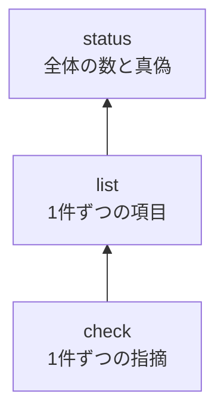

# kotowari status

English | [日本語](status.ja.md)

<!-- @kotowari[docs/decisions/core/status.md#status-reads-the-same-things-as-check-and-runs-the-same-checks-and-outputs-counts-and-complete-instead-of-findings:6190a33e] -->

`kotowari status` answers whether the decision documents (the specification) and the tests are "in place right now", with counts and a single true/false.
Add one line to your CI, and it stops changes that leave errors or open questions behind.

## Where it sits among the three read commands

<!-- @kotowari[docs/decisions/core/status.md#status-reads-the-same-things-as-check-and-runs-the-same-checks-and-outputs-counts-and-complete-instead-of-findings:6190a33e] -->

kotowari's tools for reading the specification are arranged in tiers.



- To fix what is wrong, use [`check`](./check.md)
- To see which tests are attached to which confirmation rows, use [`list`](./list.md)
- To know whether the whole is in a shippable state, use `status`

`status` has no judgment of its own; it only aggregates the results of the same configuration and the same checks as `check`.
So `check` and `status` never disagree.

## Synopsis

<!-- @kotowari[docs/decisions/core/cli.md#the-options-each-command-accepts-are-fixed-and-options-and-positional-arguments-may-be-written-in-any-order:94339fbd, docs/decisions/core/cli.md#an-option-not-accepted-an-unknown-command-an-extra-positional-argument-or-an-option-with-a-wrong-value-stops-with-an-argument-error:11a07c33] -->

```sh
kotowari status [--format json|text] [--config <path>]
kotowari status --help
kotowari status --version
```

Options may come before or after the command.
It takes no positional arguments.

## Options and arguments

<!-- @kotowari[docs/decisions/core/status.md#the-output-is-json-or-text-and-text-has-one-line-per-group:7b83738d, docs/decisions/core/config.md#the-configuration-file-is-placed-at-kotowariconfigyaml-in-the-base-directory-and---config-can-point-at-another-file:7c217b47] -->

| Name | Value | Default | Description |
|---|---|---|---|
| `--format` | `json` or `text` | `json` | The output form |
| `--config` | Path to a configuration file | `.kotowari/config.yaml` in the base directory | The configuration file to read. The path is read relative to the current directory |
| `--help` | none | — | Prints usage and exits |
| `--version` | none | — | Prints the version and exits |

Details of the common options and the base directory are in [CLI basics](../cli.md).

## Output

From the same configuration and locations as `check`, `status` reads the decision documents, test files, guides and overview data, and — when `surface.rules` is not an empty list — the surface files, the surface rule files and the list of unspecified surfaces, then runs the same checks as `check`.
It does not print the findings themselves, only counts and `complete`.

### text

<!-- @kotowari[docs/decisions/core/status.md#the-output-is-json-or-text-and-text-has-one-line-per-group:7b83738d] -->

Each group is printed on one line in the form `group key=value key=value …`.
The key words are the same as in JSON; values are separated by single spaces with no column alignment.
The last line is `complete true` or `complete false`.

Only the `tests` line expands JSON's `files` into `extension=number-of-files` pairs (for example, `tests marks=2 rs=1`).

### JSON

<!-- @kotowari[docs/decisions/core/status.md#the-summary-outputs-per-group-the-counts-of-test-markers-guides-overview-surfaces-and-findings:d52c4092, docs/decisions/core/status.md#the-number-of-confirmation-rows-is-output-split-into-those-with-tests-those-without-and-those-by-reading:4b92a0ae, docs/decisions/core/confirmations.md#the-implementing-side-changes-the-status-and-decisions-not-built-yet-stay-proposed:436adde2] -->

The top level is an object with only the following group keys.
All keys are defined in [the status decisions](../../decisions/core/status.md).

| Group | Keys | Type | Description |
|---|---|---|---|
| `documents` | `files`, `lines` | number | The number of documents read, and their total line count |
| `tests` | `marks` | number | The number of mark occurrences. A mark with several IDs counts once per ID |
| `tests` | `files` | object | The same as `tests` in the JSON of `check`. Keys are extensions; values are `files` (the number of files) and `query` (whether it is a language with a query) |
| `guides` | `files`, `marks` | number | The number of guides read and the number of guide marks (the same as `guides` in `check`) |
| `overview` | `files`, `marks` | number | The number of overview data files read and the number of guide marks in them (the same as `overview` in `check`). Both are 0 if the configuration has no `overview` key |
| `surface` | `total`, `specified`, `unspecified` | number | The number of surface kind-and-name pairs, how many of them are quoted in decisions, and how many are not but are excluded by the list of unspecified surfaces ([Surface checks](../surface.md)). All three are 0 if `surface.rules` is an empty list |
| `decisions` | `proposed`, `implemented` | number | The number of decisions in each state. A decision whose state line is wrong is counted in neither |
| `confirmations` | `with_tests`, `without_tests`, `by_reading` | number | The confirmation rows, in decisions of either state: those a test's mark points at, those no mark points at, and those that start with `(by reading)` (counted only there) |
| `findings` | `error`, `notice` | number | The number of errors and notices from `check` |
| `complete` | (value only) | boolean | Whether everything is in place. The conditions are in the next section |

### Numbers to watch

<!-- @kotowari[docs/decisions/core/status.md#the-summary-outputs-per-group-the-counts-of-test-markers-guides-overview-surfaces-and-findings:d52c4092, docs/decisions/core/status.md#the-number-of-confirmation-rows-is-output-split-into-those-with-tests-those-without-and-those-by-reading:4b92a0ae] -->

Here are just the numbers you will look at most often.

| Line | Where to look | When to worry |
|---|---|---|
| `decisions` | `proposed` | The number of decisions decided but not built yet. Not a defect; it shows how much is still to be built |
| `confirmations` | `without_tests` | Rows no test points at. For an implemented decision each is an error in `check`; rows of proposed decisions are counted here too, without an error |
| `confirmations` | `by_reading` | Rows a person or an LLM confirms by reading. kotowari does not check them, so the review does |
| `guides` | `files` / `marks` | The number of guides read and the number of guide marks. A mistyped glob in the configuration makes these 0 |
| `surface` | `unspecified` | The number of surfaces excluded by the list of unspecified surfaces without being quoted in a decision. A measure of how much adoption work remains; bring it toward 0 |
| `findings` | `error` / `notice` | The number of findings from `check`. `notice` means notices, which do not affect whether everything is in place |

### When `complete` is true

<!-- @kotowari[docs/decisions/core/status.md#the-exit-code-is-0-when-complete-and-1-otherwise:ba9a7aed, docs/decisions/core/decision-documents.md#write-questions-handed-back-to-people-in-the-open-section-of-the-topic-document:8286069a] -->

`complete` is true only when both of the following hold.

1. `check` has 0 errors (`error`)
2. No decision document has an item under `## Open`

No matter how many notices (`notice`) there are, they do not prevent `complete`.
The distinction is that notices are clues worth fixing, but not a reason to hold back a release.
Decisions left proposed do not prevent it either.

## Exit codes

<!-- @kotowari[docs/decisions/core/status.md#the-exit-code-is-0-when-complete-and-1-otherwise:ba9a7aed, docs/decisions/core/status.md#status-reads-the-same-things-as-check-and-runs-the-same-checks-and-outputs-counts-and-complete-instead-of-findings:6190a33e] -->

The exit code mirrors the `complete` answer directly.

| Code | Meaning |
|---|---|
| 0 | In place (`complete true`). Also 0 when it exits via `--help` or `--version` |
| 1 | Not in place (`complete false`) |
| 2 | Stopped (it could not aggregate, for example because the configuration could not be read. The reason goes to standard error) |

The reasons and messages for stopping are the same as for `check` ([CLI basics](../cli.md)).

## Examples

### Trying it out

<!-- @kotowari[docs/decisions/core/status.md#the-output-is-json-or-text-and-text-has-one-line-per-group:7b83738d] -->

Run it at the repository root.
For reading it yourself, `--format text` is handy.
This is the result for the decision document of [the `kotowari list` example](./list.md#example) with a test for each of its two rows checked by tests (only the groups described above are shown).

```console
$ kotowari status --format text | grep -E '^(tests|guides|overview|surface|decisions|confirmations|findings|complete)'
tests marks=2 rs=1
guides files=0 marks=0
overview files=0 marks=0
surface total=0 specified=0 unspecified=0
decisions proposed=0 implemented=2
confirmations with_tests=2 without_tests=0 by_reading=1
findings error=0 notice=0
complete true
```

The final `complete true` is the answer; the lines above it are its breakdown.

The default output is JSON, with the same key names as text.
Use it when a script or an agent reads the output.

```console
$ kotowari status | jq .complete
true
```

### Using it in CI

<!-- @kotowari[docs/decisions/core/status.md#the-exit-code-is-0-when-complete-and-1-otherwise:ba9a7aed] -->

The exit code is the verdict itself, so adding it as one step of a job is all you need.

```yaml
# GitHub Actions の例（kotowari の導入手順は省略）
- name: 仕様が揃っているか
  run: kotowari status --format text
```

If things are not in place, the job fails, and the log shows which numbers went wrong.
For the detailed reasons, run `kotowari check --format text` in the same checkout to see them one by one.

## Common pitfalls

### `without_tests` is not 0, yet check has no error

<!-- @kotowari[docs/decisions/core/status.md#the-number-of-confirmation-rows-is-output-split-into-those-with-tests-those-without-and-those-by-reading:4b92a0ae, docs/decisions/core/confirmations.md#the-implementing-side-changes-the-status-and-decisions-not-built-yet-stay-proposed:436adde2, docs/decisions/core/list.md#a-confirmation-row-gets-the-tests-that-point-at-it-and-a-decision-gets-a-fingerprint:64ab7c66] -->

`without_tests` counts the rows of proposed decisions too, and those need no test yet.
After adding a proposed decision with one row to the example:

```console
$ kotowari check --format text
$ kotowari status --format text | grep -E '^(decisions|confirmations|complete)'
decisions proposed=1 implemented=2
confirmations with_tests=2 without_tests=1 by_reading=1
complete true
```

To find the rows of implemented decisions that still need a test, read `check`, or filter `list`: `kotowari list | jq -r '.items[] | select(.kind == "confirmation" and .state == "implemented" and .tests == [] and (.by_reading | not)) | .id'`.

### `complete` is false, yet check has no error

<!-- @kotowari[docs/decisions/core/status.md#the-exit-code-is-0-when-complete-and-1-otherwise:ba9a7aed, docs/decisions/core/decision-documents.md#write-questions-handed-back-to-people-in-the-open-section-of-the-topic-document:8286069a] -->

A decision document has an item under `## Open`: a question handed back to a person is still waiting.

```console
$ kotowari check --format text
$ echo $?
0
$ kotowari status --format text | grep '^complete'
complete false
```

`complete` will not be true until the person decides, the decision is written, and the item is removed from `## Open`.

### Stopping with `config error: ...: matched by both guides.files and tests.files`

<!-- @kotowari[docs/decisions/core/status.md#status-reads-the-same-things-as-check-and-runs-the-same-checks-and-outputs-counts-and-complete-instead-of-findings:6190a33e, docs/decisions/core/guides.md#when-the-guide-and-test-locations-overlap-it-is-a-stop-with-a-configuration-error:4b7987f7] -->

Like `check`, `status` also reads guides, so it stops when the `guides.files` and `tests.files` globs in the configuration match the same file.
`list` and `query` do not read guides and do not stop this way, which is why you may see "list works but status stops".
Fix the two globs so they do not overlap ([Configuration](../config.md)).

## Related

- Specification: [the status decisions](../../decisions/core/status.md)
- Seeing findings one by one: [`kotowari check`](./check.md)
- Seeing decisions, rows and tests one by one: [`kotowari list`](./list.md)
- Seeing one decision or row with its body: [`kotowari query`](./query.md)
- Kinds of findings: [Findings](../findings.md)
- Common options, stopping and the base directory: [CLI basics](../cli.md)
- Configuration file: [Configuration](../config.md)
